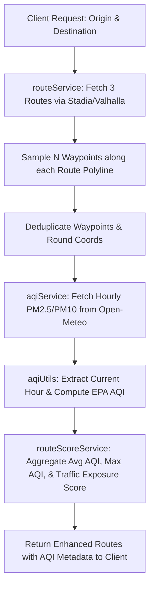

Viewed response.txt:1-60
Viewed index.ts:1-21
Viewed stadiaClient.ts:1-60
Viewed ecoRoute.ts:1-60
Viewed routeService.ts:1-60

Here is a comprehensive breakdown, architectural plan, pseudocode, and strategy to integrate the Open-Meteo Air Quality API with your route navigation engine.

---

### 1. Architectural Strategy & File Breakdown

To keep the codebase modular, testable, and maintainable, we separate concerns:

```
backend/src/
├── services/
│   ├── aqiService.ts          # [NEW] Handles fetching and parsing Open-Meteo AQI data
│   ├── routeScoreService.ts   # [NEW] Computes exposure score along route coordinates & integrates traffic
│   ├── routeService.ts        # [EXISTING] Returns routes
│   └── stadiaClient.ts       # [EXISTING]
├── utils/
│   ├── aqiUtils.ts            # [NEW] AQI calculation (e.g. US-EPA formula from PM2.5/PM10), spatial sampling
│   └── geoUtils.ts            # [EXISTING] Distance calculation, decode polylines
├── types/
│   └── aqi.types.ts           # [NEW] Open-Meteo response types, Route AQI Summary types
```

#### Why separate these files?
1. **`aqiService.ts`**: Pure HTTP API client for Open-Meteo. Isolates fetching, rate limiting, and in-memory/redis caching.
2. **`aqiUtils.ts`**: Pure math functions (e.g., converting $\text{PM}_{2.5}$ & $\text{PM}_{10}$ $\mu\text{g/m}^3$ to a standardized AQI index 0–500, point sampling along polyline paths).
3. **`routeScoreService.ts`**: Business logic combining geometry + sampled AQI + optional traffic penalty to generate an overall route eco/health score.

---

### 2. How to Get AQI for 3 Different Routes (The Path Problem)

If you only query AQI at the Start point and End point, **all 3 routes would get identical AQI scores**. To evaluate different routes accurately:

#### Solution A: Spatial Waypoint Sampling along Polyline (Recommended)
1. Decode the route's polyline into an array of `[lat, lon]` points.
2. Sample waypoints every **$X$ km** (e.g., every 3 km to 5 km) or pick $N$ equidistant points (e.g., 5 to 8 checkpoints per route).
3. Open-Meteo allows batching or querying multiple coordinates or querying unique waypoints.
4. Round coordinates to **2 decimal places** (~1.1 km precision) and cache them so overlapping points across routes don't trigger duplicate API calls.

```
Route 1 (Highway):     [Start] ──o──o──o──o── [End]  (Sampled at 4 waypoints)
Route 2 (Green belt):  [Start] ──*──*──*──*── [End]  (Sampled at 4 waypoints)
Route 3 (City center): [Start] ──#──#──#──#── [End]  (Sampled at 4 waypoints)
```

#### Solution B: Factoring in Traffic Congestion
Real-world air pollution exposure increases dramatically when idling in stop-and-go traffic. You can combine:
- **Base Background AQI**: From Open-Meteo waypoints ($AQI_{\text{ambient}}$).
- **Traffic Multiplier / Exposure Time**: 
  - Stadia Valhalla provides `time` (free-flow) vs actual congested travel time / delay per maneuver edge.
  - $\text{Delay Factor} = \frac{\text{Actual Duration}}{\text{Freeflow Duration}}$.
  - **Dynamic In-Car Exposure Score**:
    $$\text{Route Exposure Score} = \sum_{i=1}^{k} \left( AQI_i \times \text{Segment Time}_i \times \text{Congestion Factor}_i \right)$$
  - *Result:* Even if a highway has similar ambient air quality, 45 minutes of heavy idling congestion results in significantly higher personal exposure than 25 minutes on an open bypass road.

---

### 3. Step-by-Step Implementation Flow



---

### 4. Pseudocode Implementation

#### Step 1: Types (`types/aqi.types.ts`)

```typescript
export interface OpenMeteoHourlyUnits {
    time: string;
    pm10: string;
    pm2_5: string;
}

export interface OpenMeteoHourlyData {
    time: string[];
    pm10: (number | null)[];
    pm2_5: (number | null)[];
}

export interface OpenMeteoResponse {
    latitude: number;
    longitude: number;
    hourly: OpenMeteoHourlyData;
}

export interface RouteAqiSummary {
    averageAqi: number;
    maxAqi: number;
    category: "Good" | "Moderate" | "Unhealthy for Sensitive Groups" | "Unhealthy" | "Very Unhealthy" | "Hazardous";
    dominantPollutant: "PM2.5" | "PM10";
    exposureScore: number; // Duration x AQI x Traffic congestion penalty
    waypointSamples: Array<{
        lat: number;
        lon: number;
        aqi: number;
    }>;
}
```

---

#### Step 2: AQI Calculation & Sampling Utilities (`utils/aqiUtils.ts`)

```typescript
import type { Coordinate } from "../types/route.types.js";

// EPA Breakpoint tables for PM2.5 (ug/m3 -> AQI 0-500)
export function calculatePM25AQI(pm25: number): number {
    if (pm25 <= 12.0) return linearScale(pm25, 0, 12, 0, 50);
    if (pm25 <= 35.4) return linearScale(pm25, 12.1, 35.4, 51, 100);
    if (pm25 <= 55.4) return linearScale(pm25, 35.5, 55.4, 101, 150);
    if (pm25 <= 150.4) return linearScale(pm25, 55.5, 150.4, 151, 200);
    if (pm25 <= 250.4) return linearScale(pm25, 150.5, 250.4, 201, 300);
    return linearScale(pm25, 250.5, 500, 301, 500);
}

function linearScale(val: number, cLow: number, cHigh: number, iLow: number, iHigh: number): number {
    return Math.round(((iHigh - iLow) / (cHigh - cLow)) * (val - cLow) + iLow);
}

// Subsamples coordinates along route polyline (e.g. 5-7 points across the entire route)
export function sampleCoordinates(coords: Coordinate[], sampleCount: number = 6): Coordinate[] {
    if (coords.length <= sampleCount) return coords;
    const step = (coords.length - 1) / (sampleCount - 1);
    const samples: Coordinate[] = [];
    for (let i = 0; i < sampleCount; i++) {
        samples.push(coords[Math.round(i * step)]);
    }
    return samples;
}
```

---

#### Step 3: Open-Meteo AQI Service (`services/aqiService.ts`)

```typescript
const aqiCache = new Map<string, { aqi: number; timestamp: number }>();
const CACHE_TTL_MS = 30 * 60 * 1000; // 30 min cache

export async function fetchAqiForCoordinate(lat: number, lon: number): Promise<number> {
    // 1. Round to 2 decimal places to cluster nearby points (~1.1km)
    const roundedLat = Number(lat.toFixed(2));
    const roundedLon = Number(lon.toFixed(2));
    const cacheKey = `${roundedLat},${roundedLon}`;

    const cached = aqiCache.get(cacheKey);
    if (cached && Date.now() - cached.timestamp < CACHE_TTL_MS) {
        return cached.aqi;
    }

    // 2. Fetch from Open-Meteo API
    const url = `https://air-quality-api.open-meteo.com/v1/air-quality?latitude=${roundedLat}&longitude=${roundedLon}&hourly=pm10,pm2_5`;
    const res = await fetch(url);
    if (!res.ok) throw new Error(`AQI API returned ${res.status}`);

    const data = await res.json();
    
    // 3. Find current hour index
    const nowIsoHour = new Date().toISOString().slice(0, 13) + ":00";
    let hourIdx = data.hourly.time.indexOf(nowIsoHour);
    if (hourIdx === -1) hourIdx = data.hourly.time.length - 1; // Fallback to latest available

    const currentPM25 = data.hourly.pm2_5[hourIdx] ?? 0;
    const aqi = calculatePM25AQI(currentPM25);

    aqiCache.set(cacheKey, { aqi, timestamp: Date.now() });
    return aqi;
}
```

---

#### Step 4: Route AQI & Traffic Scoring Service (`services/routeScoreService.ts`)

```typescript
export async function enrichRouteWithAqi(route: FormattedRoute): Promise<FormattedRoute & { aqiSummary: RouteAqiSummary }> {
    // 1. Sample 5-7 waypoints along the route polyline
    const waypoints = sampleCoordinates(route.coordinates, 6);

    // 2. Fetch AQI for all sampled waypoints concurrently
    const aqiResults = await Promise.all(
        waypoints.map(async ([lat, lon]) => ({
            lat,
            lon,
            aqi: await fetchAqiForCoordinate(lat, lon)
        }))
    );

    // 3. Calculate Average & Max AQI
    const sumAqi = aqiResults.reduce((acc, curr) => acc + curr.aqi, 0);
    const avgAqi = Math.round(sumAqi / aqiResults.length);
    const maxAqi = Math.max(...aqiResults.map(r => r.aqi));

    // 4. Incorporate Duration & Traffic delay multiplier
    // Higher duration and congestion increase the total cumulative intake of polluted air
    const durationMinutes = route.summary.duration / 60;
    const trafficMultiplier = 1.0; // Can use Valhalla edge traffic delay if available
    const exposureScore = Math.round(avgAqi * durationMinutes * trafficMultiplier);

    return {
        ...route,
        aqiSummary: {
            averageAqi: avgAqi,
            maxAqi,
            category: getCategoryLabel(avgAqi),
            exposureScore,
            waypointSamples: aqiResults
        }
    };
}
```

---

#### Step 5: Updating `Routes/ecoRoute.ts`

In your existing [ecoRoute.ts](file:///d:/code/pollution%20maps/backend/src/Routes/ecoRoute.ts#L55-L60):
```typescript
const routes = await getDistinctRoutes(c1, c2, alternatesCount);

// Enrich each of the 3 routes with AQI along their respective paths
const enrichedRoutes = await Promise.all(
    routes.map(r => enrichRouteWithAqi(r))
);

res.json({
    status: "ok",
    data: { routes: enrichedRoutes },
    routes: enrichedRoutes
});
```

---

### 5. Frontend Visuals & Route Comparison

With this data returned, the frontend can:
1. **Badge Each Route**:
   - Route 1: `Fastest (22 mins) | AQI 142 (Moderate Exposure)`
   - Route 2: `Cleanest Air (+4 mins) | AQI 68 (Low Exposure) 🍃`
2. **Color Segments along the Polyline**:
   - Use the `waypointSamples` to draw color gradients (Green $\to$ Yellow $\to$ Red) on Mapbox/Leaflet to show *where* on the route pollution spikes (e.g. city ring road vs bypass).

Would you like me to start creating these files and integrating this logic into your backend?